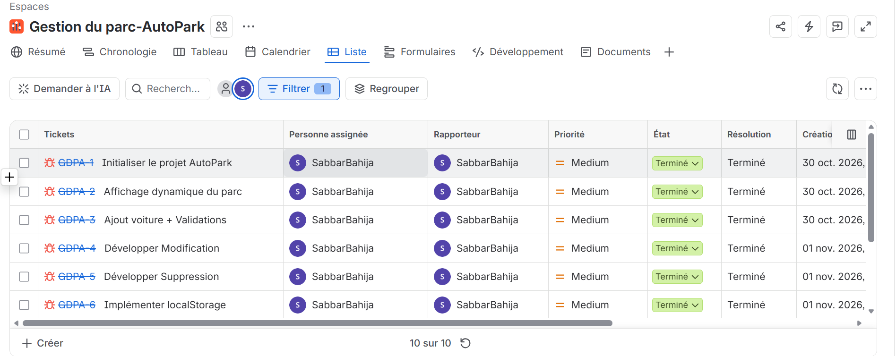
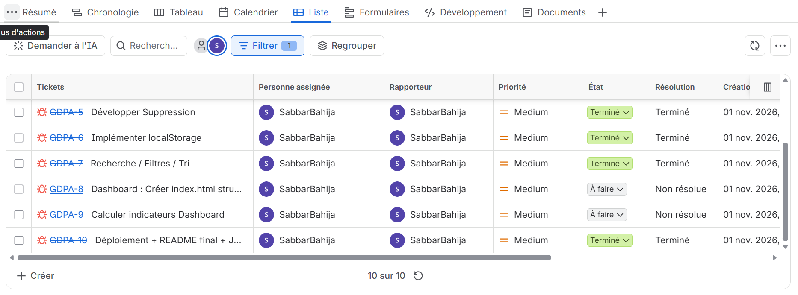

# AutoPark - Gestion de Parc Automobile

Projet individuel DWWM - Atlas Auto, agence fictive de location de voitures.

Application web vanilla JS permettant de gérer un parc automobile sans backend, avec persistance via localStorage.

### 🔗 Liens
- **Démo en ligne:** https://ton-lien-vercel.vercel.app
- **Repo GitHub:**[ https://github.com/ton-pseudo/autopark](https://github.com/bahija-sabbar/AutoPark-Gestion-d-un-parc-automobile)
- **Jira:**
- )
---

### 🚀 Présentation
AutoPark est composée de 2 pages:
1.  **Gestion du parc (`voitures.html`):** Tableau dynamique, ajout, modification, suppression, recherche, filtres et tri.
2.  **Dashboard (`index.html`):** 4 indicateurs calculés en temps réel.

L'application fonctionne 100% côté client.

### 🛠️ Technologies
- HTML5 sémantique
- CSS3 responsive (starter fourni + dashboard custom)
- JavaScript Vanilla ES6+ (modules `import/export`)
- localStorage pour la persistance
- Git / GitHub
- Jira pour le suivi

### ✨ Fonctionnalités réalisées

**4.2 Affichage:**
- Génération dynamique du tableau avec `forEach()`
- Badges visuels selon statut (Disponible / Louée / En maintenance)
- Message état vide géré avec `#etat-vide`

**4.3 Ajout:**
- `trim()` pour refuser les espaces seuls
- Contrôle prix > 0
- **Regex immatriculation:** `^[A-Z]{3}-[0-9]{3}$` (ex: ABC-123)
- Anti-doublon avec `some()` + `toLowerCase().trim()`
- Erreurs affichées près des champs `#erreur-*`
- Ajout sans rechargement + confirmation

**4.4 Modification:**
- Bouton Modifier préremplit le formulaire avec `findIndex()`
- Garde le même `id`, permet de conserver son immatriculation
- Bouton Annuler pour quitter le mode édition
- `scrollIntoView({behavior: 'smooth'})`

**4.5 Suppression:**
- `confirm()` avant suppression
- Suppression avec `filter()` + `length = 0` + `push()`

**4.6 Recherche / Filtres / Tri:**
- Recherche instantanée `input` event sur marque, modèle, immatriculation avec `includes()`
- Filtres catégorie et statut
- Tri numérique prix croissant / décroissant avec `sort()`
- `appliquerFiltres()` combine tous les critères
- Bouton réinitialiser + message si aucun résultat

**4.7 Persistance:**
- `localStorage` avec `JSON.stringify()` / `JSON.parse()`
- Sauvegarde après chaque CRUD via fonction `sauvegarder()`
- Au chargement: si sauvegarde existe on l'utilise, sinon on utilise `data.js`
- Si parc vidé volontairement, il reste vide

**4.8 Dashboard:**
- Header AutoPark + navigation entre pages
- 4 compteurs: Total, Disponibles, Louées, En maintenance calculés avec `filter()`
- Responsive mobile / tablette / desktop
- Même source de données que la gestion (localStorage)

### 📁 Structure des fichiers
